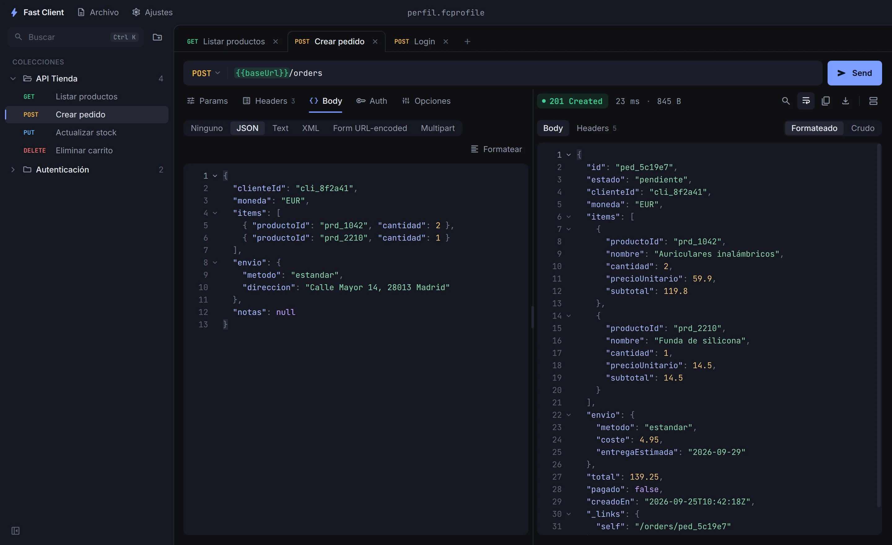

<p align="center">
  
</p>

<h1 align="center">Fast Client</h1>

<p align="center">
  Un cliente HTTP de escritorio minimalista: abre, escribe un request, pulsa <b>Send</b>.<br>
  Sin cuentas, sin nube y con todo tu trabajo en un solo archivo.
</p>

<p align="center">
  <a href="https://github.com/sanchezmendozajean/fast-client/releases/latest"><b>Descargar para Windows</b></a> ·
  <a href="https://sanchezmendozajean.github.io/fast-client/">Página del proyecto</a>
</p>

<p align="center">
  
</p>

## Características

- **Instantáneo.** Al abrir ya estás en el área de trabajo, con tus pestañas donde las dejaste.
- **Un archivo, todo tu trabajo.** Colecciones, requests, headers y variables viven en un `.fcprofile` que puedes copiar, versionar o enviar. Las respuestas del servidor nunca se guardan.
- **Offline por diseño.** La interfaz no hace llamadas de red; íconos y fuentes van dentro de la app.
- **Colecciones y pestañas** con arrastrar y soltar, renombrado en línea y restauración al reabrir.
- **Variables `{{nombre}}`** por colección, en URL, headers y body.
- **cURL de ida y vuelta:** pega un cURL en la barra de URL para importarlo o copia cualquier request como cURL.
- Body JSON, texto, XML, form URL-encoded y multipart. Auth Bearer y Basic.
- Tema oscuro, claro o según el sistema, zoom y atajos de teclado.
- Actualizaciones automáticas desde GitHub Releases (se pueden desactivar en Preferencias).

## Instalación

Descarga `Fast-Client-Setup-x.y.z.exe` desde [Releases](https://github.com/sanchezmendozajean/fast-client/releases/latest) y ejecútalo.

> El instalador aún no está firmado, así que Windows puede mostrar «Windows protegió su PC».
> Pulsa **Más información** y luego **Ejecutar de todos modos**.

Tus perfiles se guardan en `Documentos\Fast Client` y la configuración en `%APPDATA%\Fast Client`.

## Desarrollo

Requiere Node.js 22 o superior.

```bash
npm install
npm run dev          # app en modo desarrollo
npm run typecheck && npm run lint && npm test
npm run test:e2e     # pruebas end-to-end con Playwright
npm run dist         # instalador local en release/
```

Stack: Electron, electron-vite, TypeScript, React 18, Zustand, CodeMirror 6 y undici. La documentación de diseño y arquitectura está en [`docs/`](docs/README.md).

### Publicar una versión

1. Sube `version` en `package.json` y haz commit.
2. `git tag v0.2.0 && git push origin main --tags`

El workflow [`release.yml`](.github/workflows/release.yml) compila el instalador y lo publica como release. La app instalada lo detecta sola.

## Licencia

[MIT](LICENSE) © Jean Sanchez Mendoza
